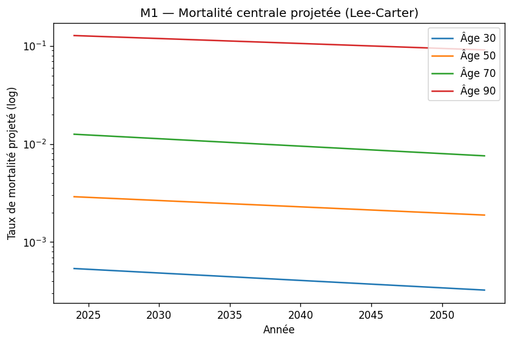
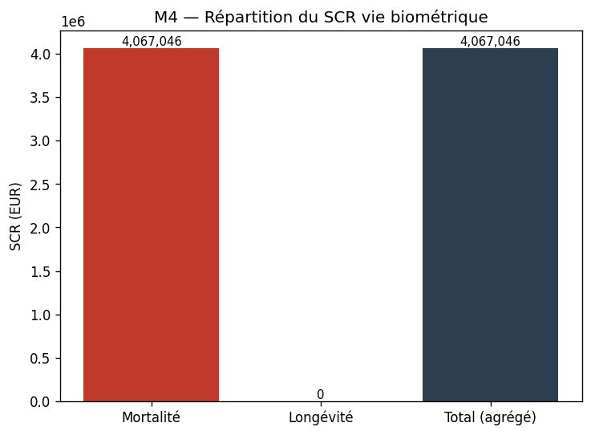

# VitaAI — Plateforme actuarielle d'assurance-vie

**Une compagnie d'assurance-vie simulée de bout en bout, en 15 modules Python : mortalité Lee-Carter, tarification, provisionnement, SCR Solvabilité II, rachats, souscription, longévité, ALM, ORSA, jusqu'à un copilote IA et un jumeau numérique. Le tout est construit uniquement sur données publiques.**

[](https://github.com/selyassine/VITA/actions/workflows/tests.yml)


<p align="center">
  
  
</p>

> Projet personnel, réalisé seul. Aucune donnée d'assureur interne : uniquement la Human Mortality Database, les courbes de taux EIOPA et des jeux de données Kaggle publics.

## En bref

- **Le cœur actuariel (M1 à M7) est approfondi** : Lee-Carter estimé par décomposition SVD sur données HMD réelles, primes et provisions prospectives validées par le principe d'équivalence actuarielle, SCR mortalité, longévité et taux sur les courbes EIOPA, VaR de longévité à 99,5 % par Monte-Carlo.
- **Les modules applicatifs (M8 à M15) sont des prototypes fonctionnels**, testés, qui relient les briques entre elles : ALM, optimisation des hypothèses, ORSA, tableau de bord, copilote IA, contrôle de complétude, jumeau numérique.
- **Les bugs de méthode sont documentés** : horizon de projection tronqué, duration calculée sur flux nets, cache périmé (voir [Choix méthodologiques](#choix-méthodologiques-clés)).
- **Les résultats sont présentés dans un site Next.js** : une page par module, une page de méthodologie et une démo interactive (tarification M2, optimisation M9).

## Les 15 modules

| # | Module | Méthode | Niveau |
| --- | --- | --- | --- |
| M1 | Mortalité | Lee-Carter, décomposition SVD, données HMD 1816–2023 | Approfondi |
| M2 | Tarification | Prime pure par équivalence actuarielle sur tables projetées | Approfondi |
| M3 | Provisionnement | Provision mathématique, méthode prospective | Approfondi |
| M4 | Solvabilité II / SCR | Chocs mortalité, longévité et taux sur courbes EIOPA RFR | Approfondi |
| M5 | Rachats (lapse) | Modèle de résiliation, label dérivé (jeu Kaggle Life Insurance Retention) | Approfondi |
| M6 | Souscription | Baseline Random Forest (jeu Prudential Life Insurance) | Approfondi |
| M7 | Longévité | VaR 99,5 % par simulation Monte-Carlo de Lee-Carter | Approfondi |
| M8 | ALM | Duration de Macaulay, écart de duration, sensibilité de la NAV aux taux | Prototype |
| M9 | Optimisation des hypothèses | Chargement optimal, arbitrage marge / rachat | Prototype |
| M10 | Risques émergents | Comparaison thématique de publications EIOPA et ACPR | Prototype |
| M11 | ORSA | Projection pluriannuelle de la solvabilité en run-off | Prototype |
| M12 | Tableau de bord | 6 graphiques de synthèse, robustesse en cas d'échec d'un module | Prototype |
| M13 | Copilote IA | Questions en langage naturel sur les résultats (API Anthropic) | Prototype |
| M14 | Conformité | Checklist documentaire ORSA / Solvabilité II (contrôle interne, pas un avis réglementaire) | Prototype |
| M15 | Jumeau numérique | Orchestration complète de M1 à M14, export JSON | Prototype |

## Sources de données

- **Human Mortality Database** : `Mx_1x1.txt` et `Exposures_1x1.txt` (1816–2023), pour M1, M7 et M9.
- **Courbes EIOPA RFR** (mai 2026, scénarios de choc inclus), pour M4 et M8.
- **Kaggle Life Insurance Retention** (10 000 contrats), pour M5. Le jeu n'a pas de label de résiliation explicite : il est dérivé, et cette limite est rappelée à chaque utilisation.
- **Kaggle Prudential Life Insurance** (`train.csv`), pour M6.

Les fichiers ne sont pas versionnés (licences et taille) : les placer dans `actuarial_platform/data/raw/`.

## Installation et tests

```bash
git clone https://github.com/selyassine/VITA.git
cd VITA/actuarial_platform
python -m venv venv
source venv/bin/activate          # Windows : venv\Scripts\activate
pip install -r requirements.txt
pytest tests/ -v                  # les tests qui demandent les fichiers HMD sont ignorés s'ils sont absents
```

Lancer un module, par exemple l'ALM : `python -m src.m8_alm.alm`.

Site de présentation :

```bash
cd ../actuarial-dashboard
npm install
npm run dev                       # http://localhost:3000, identifiants de démo : demo / vita-demo
```

## Choix méthodologiques clés

- **Horizon de projection porté de 50 à 90 ans** : la troncature à 50 ans sous-estimait sans bruit les provisions des jeunes assurés.
- **Duration de Macaulay sur les flux de prestations bruts** : les flux nets, proches de zéro par équivalence actuarielle, rendent le calcul numériquement instable.
- **Passif plafonné à zéro police par police avant agrégation**, de façon cohérente entre M3, M4 et M8.
- **Tout cache dérivé est invalidé après une correction en amont** : sinon, les tests valident silencieusement d'anciennes valeurs.

## Structure du dépôt

```
actuarial_platform/
├── config/config.yaml     # source unique : chemins, paramètres, chocs SCR
├── src/
│   ├── common/            # chargement de la configuration, portefeuille synthétique
│   └── m1_mortality/ … m15_digital_twin/
├── tests/                 # un fichier par module, plus des tests d'intégration
└── docs/architecture.md
actuarial-dashboard/       # site Next.js de présentation des résultats
```

La documentation détaillée de chaque module (hypothèses, limites, bugs corrigés) se trouve dans [`actuarial_platform/README.md`](actuarial_platform/README.md).

## Stack

Python (pandas, NumPy, SciPy, scikit-learn), pytest, Matplotlib et Plotly, API Anthropic (copilote), Next.js et TypeScript (site).

## Licence

Distribué sous licence MIT : voir [`LICENSE`](LICENSE).

---

Réalisé par **Yassine Selmi** — élève ingénieur à ESPRIT (Tunis, option Data Science) et étudiant en Master Actuariat (Le Mans Université) — [github.com/selyassine](https://github.com/selyassine)
